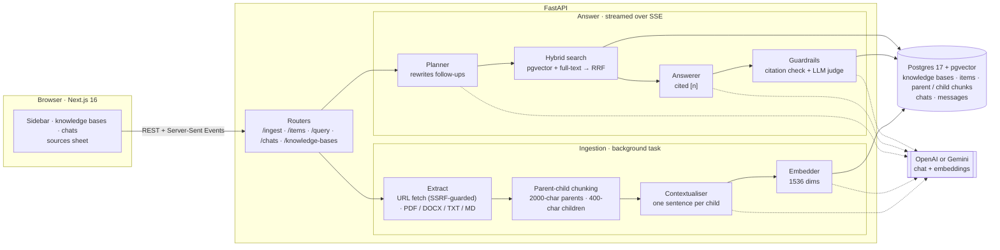

# AI Knowledge Inbox

My take-home for the Full Stack Developer role at Turium AI ([brief](docs/Turium_AI_Interview_Assignment.pdf)). Save notes, links and files into knowledge bases, then ask questions and get cited answers.

## Features

- **Knowledge bases** that take text, links (fetched on the server) and files (PDF, DOCX, TXT, MD).
- **Background ingestion.** `POST /ingest` returns `202` and each item shows `pending`, `ready` or `failed`.
- **Hybrid search.** Vector and full-text search, merged with Reciprocal Rank Fusion.
- **Streamed, cited answers.** Click a citation to see the exact chunk the model used.
- **Chats** use the knowledge bases you tick in the sidebar. Tick none and you get a general-knowledge answer, labelled as such.
- **Guardrails.** No sources means no answer, bad citations are removed, and an LLM judge checks every answer.
- **Evals.** `pnpm --filter server eval` scores retrieval and answer quality on a small golden set.
- **OpenAI or Gemini**, chosen by whichever key is in `.env`.

There's no auth. The brief asks for a single user.

## How to use it

1. **Create a knowledge base.** Click **+** next to "Knowledge bases" in the sidebar and give it a name.
2. **Add content.** Open the knowledge base and click **Add content**. Paste text, add a link, or upload a file. Wait for **Ready**.
3. **Start a new chat.** Click **New chat** in the sidebar.
4. **Pick your knowledge bases.** Tick the ones you want answers from. They lock once you send the first message. Tick none to get a general-knowledge answer.
5. **Ask.** The answer streams in with numbered citations. Click a number, or the sources button, to see the exact text it came from.

First time in? A short walkthrough opens on its own. Replay it any time from **Take the tour** at the bottom of the sidebar.

## Tech stack

| Layer | Technology |
|---|---|
| Backend | FastAPI, Pydantic v2, SQLAlchemy 2 (async), Alembic, uv |
| Database | Postgres 17 + pgvector (Docker) |
| AI | OpenAI or Google Gemini |
| Frontend | Next.js 16, React 19, TanStack Query, react-hook-form + Zod, Tailwind 4 |
| Landing page | GSAP, anime.js, Lenis |
| Tooling | pnpm + Turborepo, Biome, Ruff, mypy, Vitest, pytest |

## Getting started

You need Node.js 22+, pnpm, [uv](https://docs.astral.sh/uv/) and Docker.

```bash
pnpm install
uv sync --directory apps/server

cp apps/web/.env.example apps/web/.env
cp apps/server/.env.example apps/server/.env   # add OPENAI_API_KEY or GEMINI_API_KEY

pnpm db:up        # start Postgres
pnpm db:migrate   # create tables
pnpm dev          # web on :3000, API on :8000
```

Open http://localhost:3000. The Swagger UI is at http://localhost:8000/docs.

Other scripts: `pnpm test`, `pnpm ready` (lint and typecheck), `pnpm db:down`.

## API

| Endpoint | What it does |
|---|---|
| `POST /ingest` | Save a note or URL (`202`, processed in the background) |
| `POST /ingest/file` | Upload a file |
| `GET /items`, `DELETE /items/{id}` | List or delete saved items |
| `POST /query` | Ask a question; the answer streams back over SSE |
| `/knowledge-bases`, `/chats` | Create, list and delete knowledge bases; list chats and their history |

Request and response details are in [docs/reference/api.md](docs/reference/api.md).

## High-level design



## Tradeoffs

### 1. Chunking

- **Parent-child.** I search small 400-character chunks because they match precisely, then send the model the 2000-character section around each match.
- **Contextual.** Each small chunk gets a one-line summary of where it sits in the document, so a line like "it was rolled back" can still be found.
- **Clean splits.** Chunks break at paragraphs and sentences, and sizes are counted in characters so I don't need a tokenizer per provider.

### 2. Vector store

- **Postgres + pgvector.** Vectors live next to the rest of the data, so limiting a search to a chat's knowledge bases is just a `WHERE` clause.
- **Full-text in the same database.** That's what makes hybrid search cheap here.
- **Not a dedicated vector DB.** Qdrant or Pinecone would be a second system to keep in sync, with no gain at this size.

### 3. What breaks at scale

- **Background tasks die with the server**, so an item being processed during a restart stays `pending`.
- **Big files mean many LLM calls**, one per section for contextualising.
- **Rate limits** are retried but not queued, so a burst of uploads can use up the quota.
- **Answers take about 5 s**, because the planner, search, answer and judge run one after another.

### 4. What I'd change for production

- A real job queue with retries for ingestion.
- Auth, with each tenant's data kept separate.
- A re-ranker on top of hybrid search.
- Evals in CI that block a release when quality drops.
- Caching embeddings, and sampling the judge instead of running it on every answer.
- Tracing, plus cost metrics per request.

The longer reasoning is in [docs/reference/design-decisions.md](docs/reference/design-decisions.md), and the eval results are in [docs/reference/evaluation.md](docs/reference/evaluation.md).
